# 설비 상태·원인 진단 결과

센서 관측만으로 현재 상태와 원인 후보를 추정하는 첫 기준 모델입니다. 원인 예측은 관측과 정답의 연관성이며 물리적인 인과관계의 증명은 아닙니다.

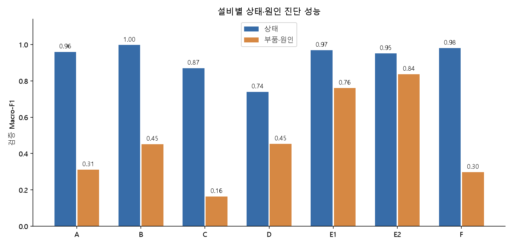

## 어떤 순서로 분석했나

1. Scenarios의 A·B·C·D·E1·E2·F 파일을 시나리오 하나씩 읽었습니다. GT_ 정답, 행 번호, 경과 시간, 정비·이상치 플래그를 입력에서 제외했습니다.
2. A/C는 과거 5분 구간을 요약하고 B는 같은 시각의 13개 공간 관측을 묶었습니다. D/E/F는 제공된 파형 특징을 썼습니다. 파형은 N/FS_HZ초 뒤에 이용 가능하다고 보수적으로 가정했습니다.
3. 현재 특징과 과거 1시간(A/B/C/D), 6시간(E/F)의 평균·변동·직전 변화량을 만들었습니다. 미래 관측이나 다른 시나리오는 섞지 않았습니다.
4. Raw/diagnostics의 START_AT ≤ 예측 시각 < END_AT 조건으로 상태·부품·유형 정답을 연결했습니다. 원인 공란은 임의로 채우지 않았습니다.
5. 원래 train 216개 중 162개를 학습, 54개를 확률 보정·보류 기준 설정에 사용했습니다. 원래 validation 72개는 별도 평가에만 사용했고 test 72개는 정답 없이 예측했습니다.
6. 설비별 ExtraTrees 상태 모델과 부품::고장유형 원인 모델을 학습했습니다. 원인 모델은 원인이 알려진 degraded/failed 표본으로 학습·평가했습니다.
7. 상태의 오분류·원인 후보·판단 보류·관측 설명을 기록했습니다. 기존 Main.py와 전처리 파일은 변경하지 않았습니다.

## 성능 읽는 법

- Macro-F1은 상태·원인별 F1을 동일 비중으로 평균한 값입니다. 단순 정확도보다 드문 이상을 놓치는 문제를 잘 드러냅니다. 비교 기준은 학습 자료의 최빈 클래스를 항상 예측하는 모델입니다.
- 신뢰구간은 독립적인 검증 시나리오를 200회 재추출한 구간입니다. 센서 행이 많아도 독립 고장 사건이 많다는 뜻은 아닙니다.
- 원인 점수는 실제 이상이고 원인이 알려진 시점에 한정된 조건부 성능입니다. 아래 설비별 end_to_end는 상태 모델이 이상을 감지한 경우까지 포함해 평가합니다.
- 자동 채택은 확률·후보 간격·관측 결측·학습 범위 경고를 통과한 비율입니다. 채택 정확도는 검증에서 측정한 실제 값이며 보장 수치가 아닙니다.
- ECE는 예측 확률과 실제 정답률의 차이입니다. 작을수록 좋습니다. 온도 보정은 완전한 확률 신뢰성을 보장하지 않습니다.

| 설비 | 목표 | 검증 행 | 정확도 | Macro-F1 | 최빈 기준 F1 | F1 95% 구간 | 자동 채택 비율 | 채택 정확도 |
|---|---|---:|---:|---:|---:|---|---:|---:|
| A | 상태 | 62,208 | 98.9% | 0.960 | 0.323 | 0.912~0.989 | 99.4% | 99.0% |
| A | 원인 | 3,045 | 37.3% | 0.312 | 0.139 | 0.082~0.434 | 0.0% | 판단 보류만 있음 |
| B | 상태 | 31,104 | 99.9% | 0.997 | 0.243 | 0.745~0.999 | 98.2% | 99.9% |
| B | 원인 | 1,496 | 79.5% | 0.452 | 0.152 | 0.201~0.499 | 72.1% | 91.1% |
| C | 상태 | 62,208 | 91.9% | 0.871 | 0.223 | 0.644~0.931 | 92.9% | 94.1% |
| C | 원인 | 10,445 | 23.2% | 0.164 | 0.090 | 0.091~0.228 | 0.0% | 판단 보류만 있음 |
| D | 상태 | 62,208 | 99.6% | 0.740 | 0.243 | 0.731~0.746 | 97.8% | 99.7% |
| D | 원인 | 2,995 | 73.6% | 0.454 | 0.158 | 0.217~0.485 | 92.9% | 74.8% |
| E1 | 상태 | 2,592 | 99.2% | 0.969 | 0.324 | 0.935~0.993 | 96.9% | 99.2% |
| E1 | 원인 | 109 | 91.7% | 0.761 | 0.105 | 0.377~0.769 | 78.9% | 95.3% |
| E2 | 상태 | 2,592 | 98.6% | 0.951 | 0.324 | 0.863~0.987 | 96.8% | 99.0% |
| E2 | 원인 | 121 | 90.9% | 0.837 | 0.059 | 0.446~0.886 | 90.9% | 90.9% |
| F | 상태 | 10,368 | 99.4% | 0.981 | 0.323 | 0.938~0.997 | 99.4% | 99.5% |
| F | 원인 | 534 | 29.0% | 0.298 | 0.086 | 0.072~0.405 | 0.0% | 판단 보류만 있음 |

## 불확실성은 어떻게 표시하나

- low_confidence: 학습 내부 보정 자료에서 정한 확률 기준 미달. 기준을 만족할 자료가 부족하면 모두 보류합니다.
- close_candidates: 1위·2위 확률 차이가 0.15 미만. 이 차이는 사전 지정한 시작 기준입니다.
- missing_observations: 현재 특징 중 20% 초과가 결측. 초기 과거창 부족 때문에 생긴 변화량 NaN과 구분합니다.
- outside_training_envelope: 현재 특징 중 10% 초과가 학습의 0.5~99.5백분위 범위 밖. 새로운 고장을 검출한다는 보장은 없는 보수적 경고입니다.
- 원인 후보 확률은 이상 상태라는 조건 아래의 점수입니다. 상태가 정상·정비면 대시보드 원인 후보를 숨깁니다. 상태 또는 원인에 보류가 있으면 원인 확정 문구를 쓰지 않습니다.

## 설비별 관측 근거와 혼동 사례

### 설비 A

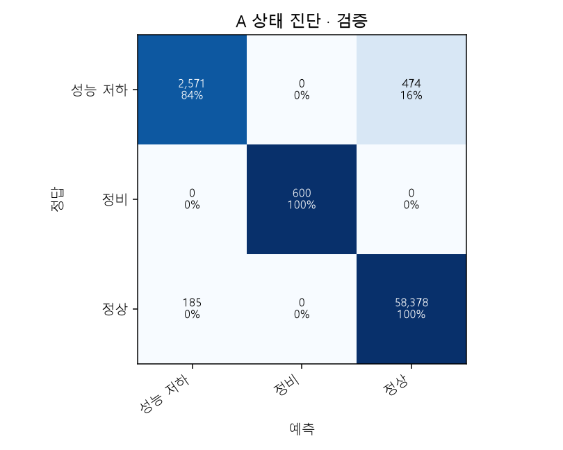

- state 평가 클래스: degraded: 3,045행, maintenance: 600행, normal: 58,563행.

- state에서 섞었을 때 F1이 가장 감소한 관측: OP-Z3 (+0.318), LOAD (+0.098), SET_TEMP (+0.003).

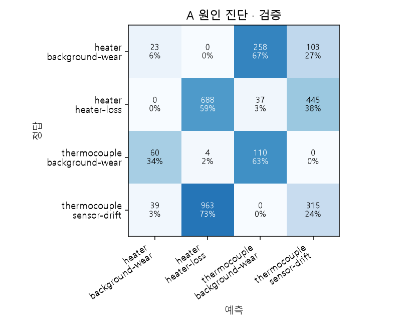

- cause 평가 클래스: heater::background-wear: 384행, heater::heater-loss: 1,170행, thermocouple::background-wear: 174행, thermocouple::sensor-drift: 1,317행.

- cause에서 섞었을 때 F1이 가장 감소한 관측: OP-Z3 (+0.059), RUNNING (+0.006), TC-Z3 (+0.004).

- 원인 상위 2개 후보 포함률: 81.9%. 부품 정확도: 37.3%.

- 상태 모델까지 포함한 이상 감지율: 84.4%. 실제 이상 시점에서 상태 감지와 원인 1위가 함께 맞은 비율: 30.3%.

| 종류 | 목표 | 상황·시각 | 정답 | 예측 / 2위 후보 | 점수 | 관측 설명 |
|---|---|---|---|---|---:|---|
| confident_error | state | S0242 2027-08-25 16:10:00+00:00 | degraded | normal / degraded | 1.00 | LOAD: 0.6330000162124634 (정상 참조 0.78, 점수 차이 +0.047) / OP-Z3: 69.69412994384766 (정상 참조 66.9, 점수 차이 +0.003) / AMBIENT: 18.705509185791016 (정상 참조 24.1, 점수 차이 +0.001) |
| confident_error | state | S0267 2027-12-03 17:15:00+00:00 | degraded | normal / degraded | 1.00 | LOAD: 0.9346799850463867 (정상 참조 0.78, 점수 차이 +0.649) / AMBIENT: 18.127180099487305 (정상 참조 24.1, 점수 차이 +0.007) / OP-Z3: 76.93270874023438 (정상 참조 66.9, 점수 차이 +0.003) |
| confident_error | state | S0221 2027-05-31 04:40:00+00:00 | normal | degraded / normal | 0.98 | OP-Z3: 77.90670776367188 (정상 참조 66.9, 점수 차이 +0.975) / LOAD: 0.796019971370697 (정상 참조 0.78, 점수 차이 +0.081) / TEMP_ERROR: -0.14639000594615936 (정상 참조 -0.00027, 점수 차이 +0.013) |
| uncertain | state | S0267 2027-12-01 05:05:00+00:00 | normal | degraded / normal | 0.50 | OP-Z3: 69.7774429321289 (정상 참조 66.9, 점수 차이 +0.500) / AMBIENT: 29.81365966796875 (정상 참조 24.1, 점수 차이 +0.247) / LOAD: 0.7207199931144714 (정상 참조 0.78, 점수 차이 +0.157) |
| uncertain | state | S0258 2027-10-27 10:55:00+00:00 | normal | degraded / normal | 0.48 | OP-Z3: 67.57463073730469 (정상 참조 66.9, 점수 차이 +0.468) / AMBIENT: 25.735389709472656 (정상 참조 24.1, 점수 차이 +0.072) / TEMP_ERROR: 0.05720999836921692 (정상 참조 -0.00027, 점수 차이 +0.018) |
| uncertain | state | S0242 2027-08-25 12:45:00+00:00 | degraded | degraded / normal | 0.50 | OP-Z3: 72.21753692626953 (정상 참조 66.9, 점수 차이 +0.466) / LOAD: 0.7849299907684326 (정상 참조 0.78, 점수 차이 +0.232) / GRADE: 2.0 (정상 참조 1, 점수 차이 +0.178) |
| correct_abnormal | state | S0267 2027-12-03 04:25:00+00:00 | degraded | degraded / failed | 1.00 | OP-Z3: 91.4097900390625 (정상 참조 66.9, 점수 차이 +0.869) / LOAD: 0.706250011920929 (정상 참조 0.78, 점수 차이 +0.004) / TEMP_ERROR: 18.137659072875977 (정상 참조 -0.00027, 점수 차이 +0.000) |
| correct_abnormal | state | S0217 2027-05-15 18:45:00+00:00 | degraded | degraded / failed | 1.00 | OP-Z3: 78.5235595703125 (정상 참조 66.9, 점수 차이 +0.991) / LOAD: 0.6373500227928162 (정상 참조 0.78, 점수 차이 +0.061) / AMBIENT: 18.10420036315918 (정상 참조 24.1, 점수 차이 +0.000) |
| correct_abnormal | state | S0242 2027-08-24 23:25:00+00:00 | degraded | degraded / failed | 1.00 | OP-Z3: 82.4842300415039 (정상 참조 66.9, 점수 차이 +0.874) / LOAD: 0.6200199723243713 (정상 참조 0.78, 점수 차이 +0.013) / TEMP_ERROR: 17.790660858154297 (정상 참조 -0.00027, 점수 차이 +0.009) |
| confident_error | cause | S0221 2027-06-02 19:25:00+00:00 | heater::background-wear | thermocouple::background-wear / heater::background-wear | 0.98 | AMBIENT: 18.38698959350586 (정상 참조 24.1, 점수 차이 +0.619) / OP-Z3: 79.32695770263672 (정상 참조 66.9, 점수 차이 +0.563) / SET_TEMP: 780.0 (정상 참조 760, 점수 차이 +0.541) |
| confident_error | cause | S0267 2027-12-01 18:00:00+00:00 | heater::heater-loss | thermocouple::sensor-drift / heater::heater-loss | 0.74 | AMBIENT: 18.000410079956055 (정상 참조 24.1, 점수 차이 +0.325) / OP-Z3: 73.97664642333984 (정상 참조 66.9, 점수 차이 +0.312) / LOAD: 0.6453999876976013 (정상 참조 0.78, 점수 차이 +0.188) |
| confident_error | cause | S0242 2027-08-25 23:25:00+00:00 | heater::background-wear | thermocouple::background-wear / thermocouple::sensor-drift | 0.63 | OP-Z3: 75.4819564819336 (정상 참조 66.9, 점수 차이 +0.283) / AMBIENT: 23.02910041809082 (정상 참조 24.1, 점수 차이 +0.272) / GRADE: 2.0 (정상 참조 1, 점수 차이 +0.264) |
| uncertain | cause | S0217 2027-05-15 10:40:00+00:00 | heater::heater-loss | thermocouple::background-wear / thermocouple::sensor-drift | 0.34 | OP-Z3: 81.24739074707031 (정상 참조 66.9, 점수 차이 +0.102) / LOAD: 0.8934599757194519 (정상 참조 0.78, 점수 차이 +0.070) / AMBIENT: 26.10732078552246 (정상 참조 24.1, 점수 차이 +0.039) |
| uncertain | cause | S0221 2027-06-02 14:05:00+00:00 | heater::background-wear | thermocouple::sensor-drift / thermocouple::background-wear | 0.27 | GRADE: 2.0 (정상 참조 1, 점수 차이 +0.026) / AMBIENT: 20.937950134277344 (정상 참조 24.1, 점수 차이 +0.013) / SET_TEMP: 780.0 (정상 참조 760, 점수 차이 +0.010) |
| uncertain | cause | S0285 2028-02-13 11:15:00+00:00 | thermocouple::sensor-drift | thermocouple::sensor-drift / heater::heater-loss | 0.33 | OP-Z3: 65.54492950439453 (정상 참조 66.9, 점수 차이 +0.058) / LOAD: 0.7900999784469604 (정상 참조 0.78, 점수 차이 +0.013) / SET_TEMP: 760.0 (정상 참조 760, 점수 차이 +0.000) |
| correct_abnormal | cause | S0217 2027-05-17 23:10:00+00:00 | thermocouple::background-wear | thermocouple::background-wear / heater::background-wear | 0.98 | OP-Z3: 75.8770523071289 (정상 참조 66.9, 점수 차이 +0.707) / AMBIENT: 22.643949508666992 (정상 참조 24.1, 점수 차이 +0.630) / TC-Z3: 779.8816528320312 (정상 참조 760, 점수 차이 +0.529) |
| correct_abnormal | cause | S0267 2027-12-03 13:30:00+00:00 | thermocouple::background-wear | thermocouple::background-wear / thermocouple::sensor-drift | 0.72 | GRADE: 2.0 (정상 참조 1, 점수 차이 +0.368) / LOAD: 0.8590099811553955 (정상 참조 0.78, 점수 차이 +0.365) / AMBIENT: 21.758480072021484 (정상 참조 24.1, 점수 차이 +0.361) |
| correct_abnormal | cause | S0285 2028-02-11 21:10:00+00:00 | thermocouple::sensor-drift | thermocouple::sensor-drift / heater::heater-loss | 0.64 | OP-Z3: 63.99837112426758 (정상 참조 66.9, 점수 차이 +0.235) / AMBIENT: 19.903310775756836 (정상 참조 24.1, 점수 차이 +0.180) / LOAD: 0.6769800186157227 (정상 참조 0.78, 점수 차이 +0.121) |

### 설비 B

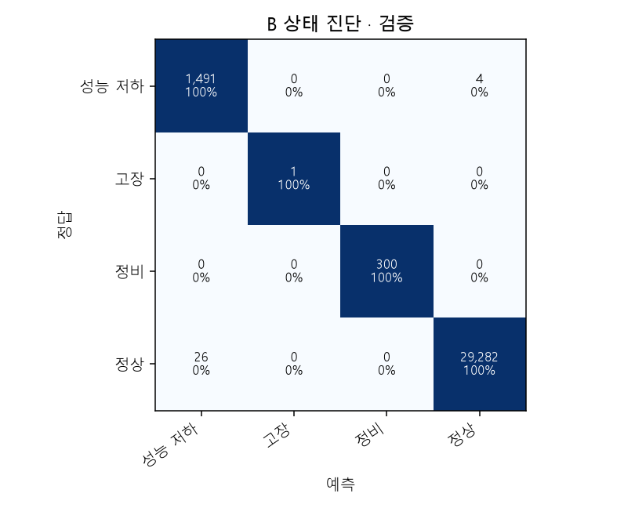

- state 평가 클래스: degraded: 1,495행, failed: 1행, maintenance: 300행, normal: 29,308행.

- state에서 섞었을 때 F1이 가장 감소한 관측: POWER_ERROR (+0.330), SPD (+0.021), RESISTANCE (+0.012).

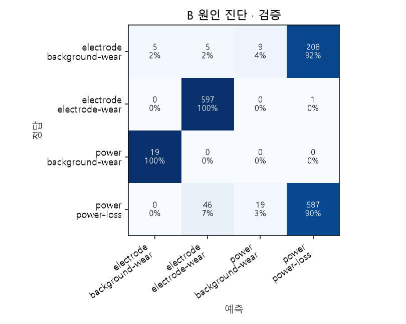

- cause 평가 클래스: electrode::background-wear: 227행, electrode::electrode-wear: 598행, power::background-wear: 19행, power::power-loss: 652행.

- cause에서 섞었을 때 F1이 가장 감소한 관측: RESISTANCE (+0.218), POWER_ERROR (+0.015), THICKNESS (+0.009).

- 원인 상위 2개 후보 포함률: 95.1%. 부품 정확도: 81.1%.

- 상태 모델까지 포함한 이상 감지율: 99.7%. 실제 이상 시점에서 상태 감지와 원인 1위가 함께 맞은 비율: 79.2%.

| 종류 | 목표 | 상황·시각 | 정답 | 예측 / 2위 후보 | 점수 | 관측 설명 |
|---|---|---|---|---|---:|---|
| confident_error | state | S0255 2027-10-14 16:10:00+00:00 | normal | degraded / normal | 1.00 | POWER_ERROR: -14.971638679504395 (정상 참조 -10.6, 점수 차이 +0.997) / SET-PWR: 62.6327018737793 (정상 참조 78, 점수 차이 +0.817) / SPD: 93.9490966796875 (정상 참조 117, 점수 차이 +0.627) |
| confident_error | state | S0230 2027-07-06 04:10:00+00:00 | normal | degraded / normal | 1.00 | POWER_ERROR: -18.46241569519043 (정상 참조 -10.6, 점수 차이 +0.995) / RESISTANCE: 1.1583000421524048 (정상 참조 1.04, 점수 차이 +0.267) / SPD: 119.4176025390625 (정상 참조 117, 점수 차이 +0.038) |
| confident_error | state | S0220 2027-05-27 03:00:00+00:00 | normal | degraded / normal | 0.99 | POWER_ERROR: -13.930830955505371 (정상 참조 -10.6, 점수 차이 +0.989) / SPD: 95.16510009765625 (정상 참조 117, 점수 차이 +0.898) / SET-PWR: 63.44340133666992 (정상 참조 78, 점수 차이 +0.841) |
| uncertain | state | S0230 2027-07-06 04:00:00+00:00 | normal | degraded / normal | 0.50 | POWER_ERROR: -16.67827606201172 (정상 참조 -10.6, 점수 차이 +0.505) / RESISTANCE: 1.1583000421524048 (정상 참조 1.04, 점수 차이 +0.457) / SPD: 118.02140045166016 (정상 참조 117, 점수 차이 +0.227) |
| uncertain | state | S0282 2028-01-30 03:00:00+00:00 | degraded | normal / degraded | 0.51 | SPD: 129.5301055908203 (정상 참조 117, 점수 차이 +0.383) / GRADE: 0.0 (정상 참조 1, 점수 차이 +0.265) / THICKNESS: 1.0 (정상 참조 1.3, 점수 차이 +0.153) |
| uncertain | state | S0232 2027-07-16 07:40:00+00:00 | normal | normal / degraded | 0.52 | SET-PWR: 79.831298828125 (정상 참조 78, 점수 차이 +0.023) / GRADE: 1.0 (정상 참조 1, 점수 차이 +0.000) / RUNNING: 1.0 (정상 참조 1, 점수 차이 +0.000) |
| correct_abnormal | state | S0282 2028-02-01 22:30:00+00:00 | degraded | degraded / failed | 1.00 | POWER_ERROR: -28.25114631652832 (정상 참조 -10.6, 점수 차이 +0.972) / PWR: 120.39664459228516 (정상 참조 88.5, 점수 차이 +0.008) / RESISTANCE: 1.0913000106811523 (정상 참조 1.04, 점수 차이 +0.001) |
| correct_abnormal | state | S0220 2027-05-27 08:50:00+00:00 | degraded | degraded / failed | 1.00 | POWER_ERROR: -28.119792938232422 (정상 참조 -10.6, 점수 차이 +0.993) / RESISTANCE: 1.228700041770935 (정상 참조 1.04, 점수 차이 +0.004) / PWR: 118.64208984375 (정상 참조 88.5, 점수 차이 +0.003) |
| correct_abnormal | state | S0255 2027-10-16 15:30:00+00:00 | degraded | degraded / failed | 1.00 | POWER_ERROR: -26.85082244873047 (정상 참조 -10.6, 점수 차이 +0.972) / PWR: 118.2645263671875 (정상 참조 88.5, 점수 차이 +0.004) / RESISTANCE: 1.0901000499725342 (정상 참조 1.04, 점수 차이 +0.001) |
| confident_error | cause | S0220 2027-05-29 11:30:00+00:00 | electrode::background-wear | power::power-loss / electrode::electrode-wear | 0.80 | POWER_ERROR: -23.799930572509766 (정상 참조 -10.6, 점수 차이 +0.354) / RESISTANCE: 1.2374000549316406 (정상 참조 1.04, 점수 차이 +0.353) / PWR: 98.35002899169922 (정상 참조 88.5, 점수 차이 +0.231) |
| confident_error | cause | S0282 2028-02-01 05:00:00+00:00 | electrode::background-wear | power::power-loss / electrode::background-wear | 0.61 | RESISTANCE: 1.080399990081787 (정상 참조 1.04, 점수 차이 +0.095) / POWER_ERROR: -24.70858383178711 (정상 참조 -10.6, 점수 차이 +0.056) / PWR: 117.85528564453125 (정상 참조 88.5, 점수 차이 +0.006) |
| confident_error | cause | S0230 2027-07-08 22:40:00+00:00 | power::background-wear | electrode::background-wear / power::power-loss | 0.46 | THICKNESS: 1.600000023841858 (정상 참조 1.3, 점수 차이 +0.151) / GRADE: 2.0 (정상 참조 1, 점수 차이 +0.139) / PWR: 79.09626770019531 (정상 참조 88.5, 점수 차이 +0.096) |
| uncertain | cause | S0220 2027-05-27 22:10:00+00:00 | power::power-loss | electrode::electrode-wear / power::power-loss | 0.49 | RESISTANCE: 1.313099980354309 (정상 참조 1.04, 점수 차이 +0.489) / GRADE: 1.0 (정상 참조 1, 점수 차이 +0.000) / SET-PWR: 67.47850036621094 (정상 참조 78, 점수 차이 +0.000) |
| uncertain | cause | S0230 2027-07-06 06:10:00+00:00 | electrode::electrode-wear | electrode::electrode-wear / power::power-loss | 0.50 | RESISTANCE: 1.1746000051498413 (정상 참조 1.04, 점수 차이 +0.301) / GRADE: 0.0 (정상 참조 1, 점수 차이 +0.089) / THICKNESS: 1.0 (정상 참조 1.3, 점수 차이 +0.011) |
| uncertain | cause | S0282 2028-02-01 15:40:00+00:00 | electrode::background-wear | power::power-loss / electrode::background-wear | 0.36 | PWR: 79.84426879882812 (정상 참조 88.5, 점수 차이 +0.018) / SET-PWR: 62.553001403808594 (정상 참조 78, 점수 차이 +0.012) / RESISTANCE: 1.087399959564209 (정상 참조 1.04, 점수 차이 +0.001) |
| correct_abnormal | cause | S0282 2028-01-31 15:30:00+00:00 | power::power-loss | power::power-loss / electrode::background-wear | 0.97 | RESISTANCE: 1.1837999820709229 (정상 참조 1.04, 점수 차이 +0.504) / POWER_ERROR: -47.826629638671875 (정상 참조 -10.6, 점수 차이 +0.461) / PWR: 131.17242431640625 (정상 참조 88.5, 점수 차이 +0.271) |
| correct_abnormal | cause | S0249 2027-09-21 17:00:00+00:00 | electrode::electrode-wear | electrode::electrode-wear / electrode::background-wear | 0.97 | RESISTANCE: 1.6480000019073486 (정상 참조 1.04, 점수 차이 +0.804) / POWER_ERROR: -28.524730682373047 (정상 참조 -10.6, 점수 차이 +0.263) / SET-PWR: 63.84560012817383 (정상 참조 78, 점수 차이 +0.215) |
| correct_abnormal | cause | S0255 2027-10-16 09:00:00+00:00 | power::power-loss | power::power-loss / electrode::background-wear | 0.97 | RESISTANCE: 1.0750000476837158 (정상 참조 1.04, 점수 차이 +0.529) / PWR: 95.94642639160156 (정상 참조 88.5, 점수 차이 +0.224) / SPD: 113.94439697265625 (정상 참조 117, 점수 차이 +0.184) |

### 설비 C

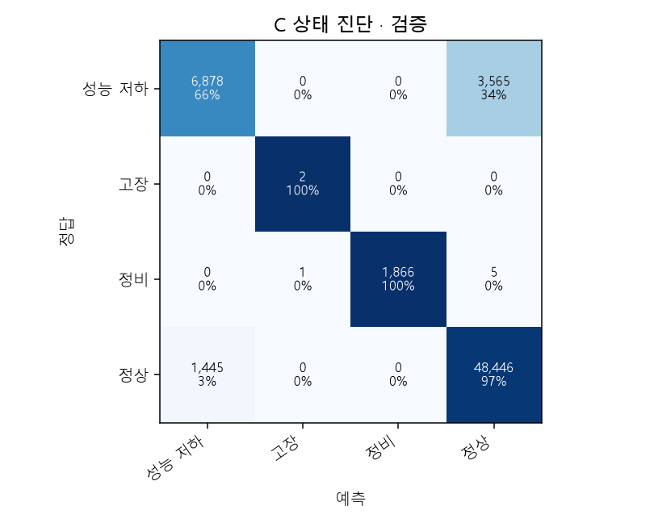

- state 평가 클래스: degraded: 10,443행, failed: 2행, maintenance: 1,872행, normal: 49,891행.

- state에서 섞었을 때 F1이 가장 감소한 관측: MLD-LVL (+0.198), CONTROL_DELAY (+0.020), OSC-STK (+0.014).

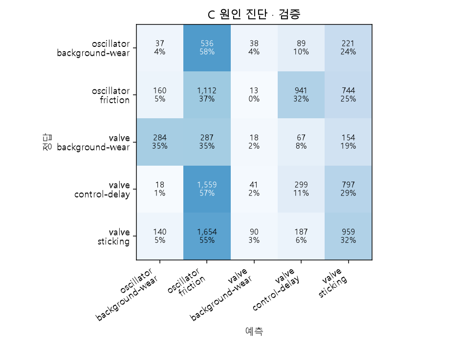

- cause 평가 클래스: oscillator::background-wear: 921행, oscillator::friction: 2,970행, valve::background-wear: 810행, valve::control-delay: 2,714행, valve::sticking: 3,030행.

- cause에서 섞었을 때 F1이 가장 감소한 관측: LOAD (+0.006), WD-SPD (+0.005), RUNNING (+0.003).

- 원인 상위 2개 후보 포함률: 51.6%. 부품 정확도: 42.7%.

- 상태 모델까지 포함한 이상 감지율: 65.9%. 실제 이상 시점에서 상태 감지와 원인 1위가 함께 맞은 비율: 15.4%.

| 종류 | 목표 | 상황·시각 | 정답 | 예측 / 2위 후보 | 점수 | 관측 설명 |
|---|---|---|---|---|---:|---|
| confident_error | state | S0284 2028-02-09 22:10:00+00:00 | degraded | normal / degraded | 1.00 | CONTROL_DELAY: 0.08756666630506516 (정상 참조 0.113, 점수 차이 +0.077) / WD-LOD: 80.63155364990234 (정상 참조 84.8, 점수 차이 +0.040) / MLD-LVL: 71.13925170898438 (정상 참조 70.2, 점수 차이 +0.029) |
| confident_error | state | S0260 2027-11-05 20:15:00+00:00 | degraded | normal / degraded | 1.00 | CONTROL_DELAY: 0.07539833337068558 (정상 참조 0.113, 점수 차이 +0.259) / OSC-STK: 3.328693389892578 (정상 참조 4.18, 점수 차이 +0.071) / MLD-LVL: 69.03998565673828 (정상 참조 70.2, 점수 차이 +0.050) |
| confident_error | state | S0276 2028-01-06 06:25:00+00:00 | normal | degraded / normal | 0.99 | MLD-LVL: 68.61196899414062 (정상 참조 70.2, 점수 차이 +0.535) / CONTROL_DELAY: 0.21580666303634644 (정상 참조 0.113, 점수 차이 +0.139) / OSC-STK: 4.884271621704102 (정상 참조 4.18, 점수 차이 +0.042) |
| uncertain | state | S0276 2028-01-06 01:05:00+00:00 | normal | normal / degraded | 0.50 | OSC-STK: 4.870643138885498 (정상 참조 4.18, 점수 차이 +0.225) / CONTROL_DELAY: 0.1964416652917862 (정상 참조 0.113, 점수 차이 +0.051) / WD-LOD: 82.42501831054688 (정상 참조 84.8, 점수 차이 +0.039) |
| uncertain | state | S0252 2027-10-02 13:25:00+00:00 | normal | normal / degraded | 0.50 | CONTROL_DELAY: 0.16929833590984344 (정상 참조 0.113, 점수 차이 +0.160) / OSC-STK: 4.733368396759033 (정상 참조 4.18, 점수 차이 +0.070) / LOAD: 0.7875099778175354 (정상 참조 0.781, 점수 차이 +0.006) |
| uncertain | state | S0236 2027-07-30 07:55:00+00:00 | normal | normal / degraded | 0.50 | WD-LOD: 106.76182556152344 (정상 참조 84.8, 점수 차이 +0.049) / LOAD: 0.9346299767494202 (정상 참조 0.781, 점수 차이 +0.006) / OSC-FRQ: 2.0 (정상 참조 2, 점수 차이 +0.000) |
| correct_abnormal | state | S0277 2028-01-11 09:45:00+00:00 | degraded | degraded / failed | 1.00 | MLD-LVL: 65.90140533447266 (정상 참조 70.2, 점수 차이 +0.873) / CONTROL_DELAY: 0.1465499997138977 (정상 참조 0.113, 점수 차이 +0.089) / LOAD: 0.7625733613967896 (정상 참조 0.781, 점수 차이 +0.000) |
| correct_abnormal | state | S0286 2028-02-17 12:25:00+00:00 | degraded | degraded / failed | 1.00 | MLD-LVL: 72.55765533447266 (정상 참조 70.2, 점수 차이 +0.481) / CONTROL_DELAY: 0.22601667046546936 (정상 참조 0.113, 점수 차이 +0.222) / WD-LOD: 101.42857360839844 (정상 참조 84.8, 점수 차이 +0.053) |
| correct_abnormal | state | S0276 2028-01-08 23:30:00+00:00 | degraded | degraded / failed | 1.00 | MLD-LVL: 70.06707000732422 (정상 참조 70.2, 점수 차이 +0.554) / CONTROL_DELAY: 0.2158450037240982 (정상 참조 0.113, 점수 차이 +0.145) / WD-LOD: 75.6557388305664 (정상 참조 84.8, 점수 차이 +0.052) |
| confident_error | cause | S0277 2028-01-11 12:15:00+00:00 | valve::sticking | oscillator::friction / valve::sticking | 0.71 | MLD-LVL: 70.1380386352539 (정상 참조 70.2, 점수 차이 +0.463) / CONTROL_DELAY: 0.1530216634273529 (정상 참조 0.113, 점수 차이 +0.292) / WD-LOD: 107.79975128173828 (정상 참조 84.8, 점수 차이 +0.262) |
| confident_error | cause | S0286 2028-02-17 12:25:00+00:00 | valve::control-delay | oscillator::friction / valve::control-delay | 0.62 | OSC-STK: 3.0821216106414795 (정상 참조 4.18, 점수 차이 +0.334) / MLD-LVL: 72.55765533447266 (정상 참조 70.2, 점수 차이 +0.202) / CONTROL_DELAY: 0.22601667046546936 (정상 참조 0.113, 점수 차이 +0.199) |
| confident_error | cause | S0253 2027-10-07 10:50:00+00:00 | oscillator::friction | valve::control-delay / valve::sticking | 0.58 | MLD-LVL: 70.4202651977539 (정상 참조 70.2, 점수 차이 +0.428) / CONTROL_DELAY: 0.24344833195209503 (정상 참조 0.113, 점수 차이 +0.235) / WD-LOD: 89.2293930053711 (정상 참조 84.8, 점수 차이 +0.214) |
| uncertain | cause | S0234 2027-07-22 17:55:00+00:00 | valve::sticking | valve::background-wear / valve::sticking | 0.24 | OSC-STK: 3.5310633182525635 (정상 참조 4.18, 점수 차이 +0.118) / CONTROL_DELAY: 0.1588066667318344 (정상 참조 0.113, 점수 차이 +0.033) / WD-SPD: 0.9152250289916992 (정상 참조 0.937, 점수 차이 +0.011) |
| uncertain | cause | S0271 2027-12-18 05:50:00+00:00 | valve::control-delay | valve::sticking / oscillator::friction | 0.33 | MLD-LVL: 66.10419464111328 (정상 참조 70.2, 점수 차이 +0.123) / CONTROL_DELAY: 0.1808333396911621 (정상 참조 0.113, 점수 차이 +0.113) / OSC-STK: 3.638974905014038 (정상 참조 4.18, 점수 차이 +0.047) |
| uncertain | cause | S0277 2028-01-12 05:15:00+00:00 | valve::sticking | oscillator::friction / valve::sticking | 0.39 | WD-LOD: 108.80189514160156 (정상 참조 84.8, 점수 차이 +0.098) / LOAD: 0.8470866680145264 (정상 참조 0.781, 점수 차이 +0.001) / OSC-FRQ: 2.0 (정상 참조 2, 점수 차이 +0.000) |
| correct_abnormal | cause | S0277 2028-01-12 05:45:00+00:00 | valve::sticking | valve::sticking / oscillator::friction | 0.54 | CONTROL_DELAY: 0.19944000244140625 (정상 참조 0.113, 점수 차이 +0.348) / MLD-LVL: 64.68394470214844 (정상 참조 70.2, 점수 차이 +0.235) / OSC-STK: 3.6457083225250244 (정상 참조 4.18, 점수 차이 +0.208) |
| correct_abnormal | cause | S0260 2027-11-04 07:00:00+00:00 | oscillator::friction | oscillator::friction / valve::sticking | 0.49 | MLD-LVL: 66.47334289550781 (정상 참조 70.2, 점수 차이 +0.166) / WD-LOD: 100.09942626953125 (정상 참조 84.8, 점수 차이 +0.163) / OSC-STK: 2.941206693649292 (정상 참조 4.18, 점수 차이 +0.156) |
| correct_abnormal | cause | S0237 2027-08-04 15:35:00+00:00 | oscillator::friction | oscillator::friction / valve::control-delay | 0.44 | MLD-LVL: 68.18726348876953 (정상 참조 70.2, 점수 차이 +0.116) / WD-LOD: 99.27915954589844 (정상 참조 84.8, 점수 차이 +0.092) / CONTROL_DELAY: 0.264781653881073 (정상 참조 0.113, 점수 차이 +0.057) |

### 설비 D

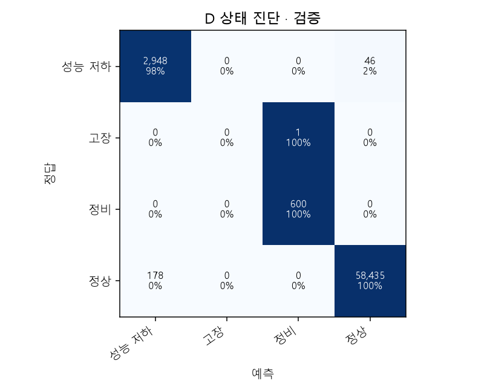

- state 평가 클래스: degraded: 2,994행, failed: 1행, maintenance: 600행, normal: 58,613행.

- state에서 섞었을 때 F1이 가장 감소한 관측: CUR-MTR_RMS (+0.264), LOAD (+0.248), VIB-TOP_CRF (+0.015).

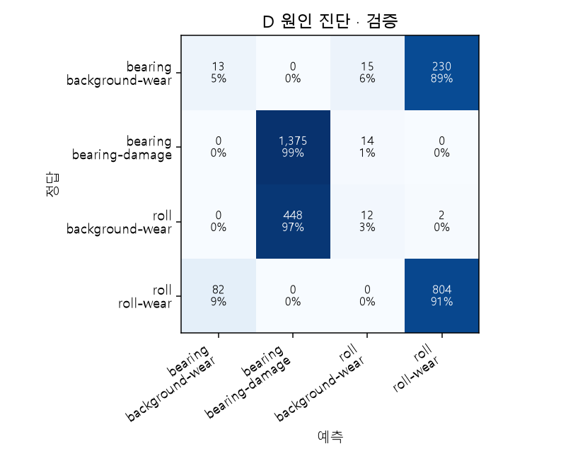

- cause 평가 클래스: bearing::background-wear: 258행, bearing::bearing-damage: 1,389행, roll::background-wear: 462행, roll::roll-wear: 886행.

- cause에서 섞었을 때 F1이 가장 감소한 관측: VIB-TOP_KUR (+0.101), VIB-TOP_CRF (+0.034), LOAD (+0.009).

- 원인 상위 2개 후보 포함률: 94.4%. 부품 정확도: 73.7%.

- 상태 모델까지 포함한 이상 감지율: 98.4%. 실제 이상 시점에서 상태 감지와 원인 1위가 함께 맞은 비율: 73.0%.

| 종류 | 목표 | 상황·시각 | 정답 | 예측 / 2위 후보 | 점수 | 관측 설명 |
|---|---|---|---|---|---:|---|
| confident_error | state | S0239 2027-08-13 22:25:01.800000+00:00 | normal | degraded / normal | 1.00 | VIB-TOP_CRF: 2.6707000732421875 (정상 참조 1.52, 점수 차이 +0.629) / VIB-TOP_RMS: 0.7576000094413757 (정상 참조 0.394, 점수 차이 +0.594) / VIB-TOP_KUR: 1.1032999753952026 (정상 참조 -1.35, 점수 차이 +0.567) |
| confident_error | state | S0252 2027-10-03 10:05:01.800000+00:00 | normal | degraded / normal | 1.00 | VIB-TOP_CRF: 2.812999963760376 (정상 참조 1.52, 점수 차이 +0.937) / VIB-TOP_KUR: 1.4498000144958496 (정상 참조 -1.35, 점수 차이 +0.720) / LOAD: 0.6294999718666077 (정상 참조 0.78, 점수 차이 +0.105) |
| confident_error | state | S0261 2027-11-07 23:20:01.800000+00:00 | degraded | normal / degraded | 1.00 | LOAD: 0.7836999893188477 (정상 참조 0.78, 점수 차이 +0.004) / VIB-TOP_RMS: 0.4361000061035156 (정상 참조 0.394, 점수 차이 +0.001) / VIB-TOP_STD: 0.4359999895095825 (정상 참조 0.374, 점수 차이 +0.001) |
| uncertain | state | S0239 2027-08-13 16:10:01.800000+00:00 | normal | normal / degraded | 0.50 | LOAD: 0.9212999939918518 (정상 참조 0.78, 점수 차이 +0.312) / VIB-BOT_RMS: 0.5652999877929688 (정상 참조 0.387, 점수 차이 -0.141) / VIB-TOP_STD: 0.6140999794006348 (정상 참조 0.374, 점수 차이 -0.250) |
| uncertain | state | S0287 2028-02-19 00:25:01.800000+00:00 | normal | degraded / normal | 0.50 | VIB-TOP_KUR: 2.817500114440918 (정상 참조 -1.35, 점수 차이 +0.490) / VIB-TOP_CRF: 2.959199905395508 (정상 참조 1.52, 점수 차이 +0.463) / VIB-BOT_RMS: 0.5547999739646912 (정상 참조 0.387, 점수 차이 +0.087) |
| uncertain | state | S0278 2028-01-14 11:45:01.800000+00:00 | degraded | normal / degraded | 0.50 | VIB-BOT_RMS: 0.4885999858379364 (정상 참조 0.387, 점수 차이 +0.204) / VIB-TOP_RMS: 0.5013999938964844 (정상 참조 0.394, 점수 차이 +0.135) / VIB-TOP_STD: 0.5013999938964844 (정상 참조 0.374, 점수 차이 -0.129) |
| correct_abnormal | state | S0287 2028-02-21 21:10:01.800000+00:00 | degraded | degraded / failed | 1.00 | VIB-TOP_KUR: 3.4237000942230225 (정상 참조 -1.35, 점수 차이 +0.331) / VIB-TOP_CRF: 3.2026000022888184 (정상 참조 1.52, 점수 차이 +0.186) / VIB-TOP_RMS: 0.7355999946594238 (정상 참조 0.394, 점수 차이 +0.019) |
| correct_abnormal | state | S0261 2027-11-08 18:40:01.800000+00:00 | degraded | degraded / failed | 1.00 | CUR-MTR_RMS: 110.89019775390625 (정상 참조 87.6, 점수 차이 +0.060) / VIB-TOP_CRF: 1.5542000532150269 (정상 참조 1.52, 점수 차이 +0.009) / VIB-TOP_KUR: -1.365399956703186 (정상 참조 -1.35, 점수 차이 +0.000) |
| correct_abnormal | state | S0239 2027-08-11 15:15:01.800000+00:00 | degraded | degraded / failed | 1.00 | VIB-TOP_RMS: 0.6542999744415283 (정상 참조 0.394, 점수 차이 +0.219) / VIB-TOP_KUR: 1.8906999826431274 (정상 참조 -1.35, 점수 차이 +0.167) / VIB-TOP_CRF: 2.659600019454956 (정상 참조 1.52, 점수 차이 +0.062) |
| confident_error | cause | S0287 2028-02-21 22:25:01.800000+00:00 | roll::background-wear | bearing::bearing-damage / bearing::background-wear | 1.00 | VIB-TOP_KUR: 2.266900062561035 (정상 참조 -1.35, 점수 차이 +0.531) / VIB-TOP_CRF: 3.10479998588562 (정상 참조 1.52, 점수 차이 +0.360) / VIB-TOP_RMS: 0.6834999918937683 (정상 참조 0.394, 점수 차이 +0.354) |
| confident_error | cause | S0261 2027-11-09 20:05:01.800000+00:00 | bearing::background-wear | roll::roll-wear / bearing::background-wear | 1.00 | VIB-TOP_CRF: 1.6766999959945679 (정상 참조 1.52, 점수 차이 +0.591) / CUR-MTR_RMS: 102.92549896240234 (정상 참조 87.6, 점수 차이 +0.161) / LOAD: 0.76910001039505 (정상 참조 0.78, 점수 차이 +0.107) |
| confident_error | cause | S0252 2027-10-03 14:50:01.800000+00:00 | roll::background-wear | bearing::bearing-damage / bearing::background-wear | 1.00 | VIB-TOP_KUR: 4.444799900054932 (정상 참조 -1.35, 점수 차이 +0.580) / VIB-TOP_RMS: 0.6841999888420105 (정상 참조 0.394, 점수 차이 +0.433) / VIB-TOP_CRF: 3.021699905395508 (정상 참조 1.52, 점수 차이 +0.396) |
| uncertain | cause | S0287 2028-02-19 04:20:01.800000+00:00 | bearing::bearing-damage | bearing::bearing-damage / roll::background-wear | 0.50 | VIB-TOP_KUR: -0.18889999389648438 (정상 참조 -1.35, 점수 차이 +0.216) / VIB-BOT_RMS: 0.5771999955177307 (정상 참조 0.387, 점수 차이 +0.134) / VIB-TOP_CRF: 2.4647998809814453 (정상 참조 1.52, 점수 차이 +0.102) |
| uncertain | cause | S0261 2027-11-07 07:15:01.800000+00:00 | roll::roll-wear | roll::roll-wear / bearing::background-wear | 0.50 | VIB-TOP_CRF: 1.7755000591278076 (정상 참조 1.52, 점수 차이 +0.249) / LOAD: 0.6855999827384949 (정상 참조 0.78, 점수 차이 +0.043) / VIB-TOP_KUR: -1.2278000116348267 (정상 참조 -1.35, 점수 차이 +0.029) |
| uncertain | cause | S0278 2028-01-14 11:40:01.800000+00:00 | roll::roll-wear | roll::roll-wear / bearing::background-wear | 0.50 | VIB-BOT_RMS: 0.4772000014781952 (정상 참조 0.387, 점수 차이 +0.053) / VIB-TOP_RMS: 0.4982999861240387 (정상 참조 0.394, 점수 차이 +0.047) / VIB-TOP_STD: 0.49799999594688416 (정상 참조 0.374, 점수 차이 +0.033) |
| correct_abnormal | cause | S0287 2028-02-20 12:20:01.800000+00:00 | bearing::bearing-damage | bearing::bearing-damage / bearing::background-wear | 1.00 | VIB-TOP_KUR: 3.388000011444092 (정상 참조 -1.35, 점수 차이 +0.483) / VIB-TOP_CRF: 2.835900068283081 (정상 참조 1.52, 점수 차이 +0.329) / VIB-TOP_RMS: 1.3939000368118286 (정상 참조 0.394, 점수 차이 +0.295) |
| correct_abnormal | cause | S0278 2028-01-14 19:15:01.800000+00:00 | roll::roll-wear | roll::roll-wear / bearing::background-wear | 1.00 | VIB-TOP_CRF: 1.6360000371932983 (정상 참조 1.52, 점수 차이 +0.521) / LOAD: 0.699400007724762 (정상 참조 0.78, 점수 차이 +0.102) / VIB-TOP_STD: 0.47620001435279846 (정상 참조 0.374, 점수 차이 +0.095) |
| correct_abnormal | cause | S0239 2027-08-11 15:20:01.800000+00:00 | bearing::bearing-damage | bearing::bearing-damage / bearing::background-wear | 1.00 | VIB-TOP_KUR: 1.0994999408721924 (정상 참조 -1.35, 점수 차이 +0.536) / VIB-TOP_RMS: 0.6525999903678894 (정상 참조 0.394, 점수 차이 +0.376) / VIB-BOT_RMS: 0.6320000290870667 (정상 참조 0.387, 점수 차이 +0.361) |

### 설비 E1

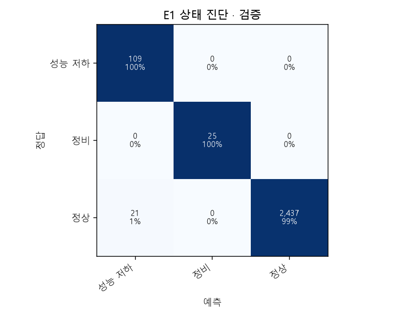

- state 평가 클래스: degraded: 109행, maintenance: 25행, normal: 2,458행.

- state에서 섞었을 때 F1이 가장 감소한 관측: VIB-MDE_CRF (+0.003), RPM (+0.003), VIB-FDE_RMS (+0.001).

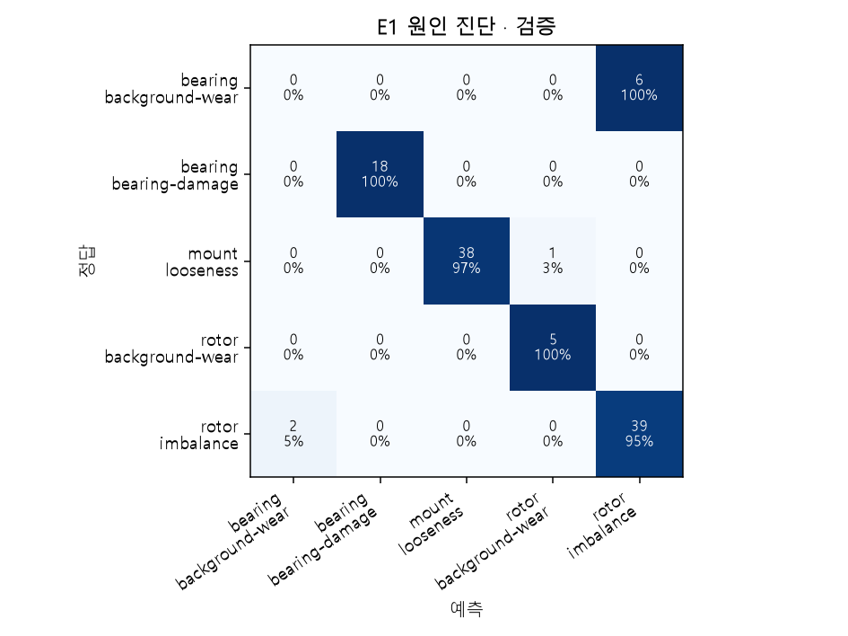

- cause 평가 클래스: bearing::background-wear: 6행, bearing::bearing-damage: 18행, mount::looseness: 39행, rotor::background-wear: 5행, rotor::imbalance: 41행.

- cause에서 섞었을 때 F1이 가장 감소한 관측: VIB-MDE_CRF (+0.440), VIB-MDE_KUR (+0.040), RPM (+0.000).

- 원인 상위 2개 후보 포함률: 100.0%. 부품 정확도: 91.7%.

- 상태 모델까지 포함한 이상 감지율: 100.0%. 실제 이상 시점에서 상태 감지와 원인 1위가 함께 맞은 비율: 91.7%.

| 종류 | 목표 | 상황·시각 | 정답 | 예측 / 2위 후보 | 점수 | 관측 설명 |
|---|---|---|---|---|---:|---|
| confident_error | state | S0244 2027-09-02 22:00:00.500000+00:00 | normal | degraded / normal | 0.99 | VIB-FNDE_RMS: 0.5802000164985657 (정상 참조 0.38, 점수 차이 +0.468) / VIB-FDE_RMS: 0.6000000238418579 (정상 참조 0.398, 점수 차이 +0.362) / VIB-MDE_KUR: -0.7519000172615051 (정상 참조 -1.47, 점수 차이 +0.285) |
| confident_error | state | S0226 2027-06-20 10:00:00.500000+00:00 | normal | degraded / normal | 0.99 | VIB-FNDE_RMS: 0.5695000290870667 (정상 참조 0.38, 점수 차이 +0.453) / VIB-MDE_KUR: 1.3463000059127808 (정상 참조 -1.47, 점수 차이 +0.341) / VIB-FDE_RMS: 0.5849999785423279 (정상 참조 0.398, 점수 차이 +0.331) |
| confident_error | state | S0219 2027-05-24 00:00:00.500000+00:00 | normal | degraded / normal | 0.88 | VIB-FDE_RMS: 0.690500020980835 (정상 참조 0.398, 점수 차이 +0.394) / VIB-FNDE_RMS: 0.4584999978542328 (정상 참조 0.38, 점수 차이 +0.255) / VIB-MDE_RMS: 0.8899000287055969 (정상 참조 0.414, 점수 차이 +0.210) |
| uncertain | state | S0279 2028-01-20 08:00:00.500000+00:00 | normal | normal / degraded | 0.51 | VIB-MDE_CRF: 1.5583000183105469 (정상 참조 1.62, 점수 차이 +0.027) / VIB-MDE_KUR: -1.4768999814987183 (정상 참조 -1.47, 점수 차이 +0.022) / RPM: 1163.6456298828125 (정상 참조 1.13e+03, 점수 차이 +0.015) |
| uncertain | state | S0244 2027-09-01 20:00:00.500000+00:00 | degraded | degraded / normal | 0.98 | VIB-FDE_RMS: 1.123900055885315 (정상 참조 0.398, 점수 차이 +0.312) / VIB-FNDE_RMS: 1.0999000072479248 (정상 참조 0.38, 점수 차이 +0.240) / VIB-MNDE_RMS: 1.1435999870300293 (정상 참조 0.411, 점수 차이 +0.224) |
| uncertain | state | S0219 2027-05-23 10:00:00.500000+00:00 | degraded | degraded / normal | 1.00 | VIB-FDE_RMS: 0.9192000031471252 (정상 참조 0.398, 점수 차이 +0.449) / VIB-MDE_STD: 1.166200041770935 (정상 참조 0.413, 점수 차이 +0.313) / VIB-MNDE_RMS: 1.1058000326156616 (정상 참조 0.411, 점수 차이 +0.292) |
| correct_abnormal | state | S0219 2027-05-23 14:00:00.500000+00:00 | degraded | degraded / maintenance | 1.00 | VIB-FDE_RMS: 1.1268999576568604 (정상 참조 0.398, 점수 차이 +0.402) / VIB-FNDE_RMS: 0.8251000046730042 (정상 참조 0.38, 점수 차이 +0.318) / VIB-MNDE_RMS: 1.3356000185012817 (정상 참조 0.411, 점수 차이 +0.291) |
| correct_abnormal | state | S0226 2027-06-22 20:00:00.500000+00:00 | degraded | degraded / maintenance | 1.00 | VIB-FDE_RMS: 1.0448999404907227 (정상 참조 0.398, 점수 차이 +0.283) / VIB-FNDE_RMS: 1.0190000534057617 (정상 참조 0.38, 점수 차이 +0.263) / VIB-MNDE_RMS: 1.066100001335144 (정상 참조 0.411, 점수 차이 +0.181) |
| correct_abnormal | state | S0275 2028-01-02 22:00:00.500000+00:00 | degraded | degraded / maintenance | 1.00 | VIB-FNDE_RMS: 0.8111000061035156 (정상 참조 0.38, 점수 차이 +0.310) / VIB-FDE_RMS: 0.8323000073432922 (정상 참조 0.398, 점수 차이 +0.298) / VIB-MNDE_RMS: 0.8457000255584717 (정상 참조 0.411, 점수 차이 +0.193) |
| confident_error | cause | S0219 2027-05-25 16:00:00.500000+00:00 | bearing::background-wear | rotor::imbalance / bearing::background-wear | 1.00 | VIB-FNDE_RMS: 0.579200029373169 (정상 참조 0.38, 점수 차이 +0.252) / VIB-MDE_RMS: 1.0917999744415283 (정상 참조 0.414, 점수 차이 +0.235) / VIB-MDE_STD: 1.090499997138977 (정상 참조 0.413, 점수 차이 +0.193) |
| confident_error | cause | S0275 2028-01-04 16:00:00.500000+00:00 | mount::looseness | rotor::background-wear / mount::looseness | 0.64 | VIB-MDE_CRF: 1.9491000175476074 (정상 참조 1.62, 점수 차이 +0.326) / VIB-MDE_KUR: -0.7314000129699707 (정상 참조 -1.47, 점수 차이 +0.270) / VIB-FNDE_RMS: 0.5300999879837036 (정상 참조 0.38, 점수 차이 +0.053) |
| confident_error | cause | S0246 2027-09-10 10:00:00.500000+00:00 | rotor::imbalance | bearing::background-wear / rotor::imbalance | 0.59 | VIB-MDE_CRF: 1.561400055885315 (정상 참조 1.62, 점수 차이 +0.057) / VIB-MDE_RMS: 0.8258000016212463 (정상 참조 0.414, 점수 차이 +0.031) / LOAD: 0.7361000180244446 (정상 참조 0.78, 점수 차이 +0.028) |
| uncertain | cause | S0246 2027-09-08 10:00:00.500000+00:00 | rotor::imbalance | bearing::background-wear / rotor::imbalance | 0.53 | VIB-MDE_CRF: 1.5698000192642212 (정상 참조 1.62, 점수 차이 +0.039) / VIB-MDE_RMS: 0.807200014591217 (정상 참조 0.414, 점수 차이 +0.035) / VIB-MDE_STD: 0.8068000078201294 (정상 참조 0.413, 점수 차이 +0.001) |
| uncertain | cause | S0226 2027-06-20 14:00:00.500000+00:00 | bearing::bearing-damage | bearing::bearing-damage / rotor::background-wear | 0.60 | VIB-MDE_CRF: 3.2808001041412354 (정상 참조 1.62, 점수 차이 +0.486) / VIB-MDE_KUR: 1.6511000394821167 (정상 참조 -1.47, 점수 차이 +0.254) / VIB-MDE_RMS: 0.6848999857902527 (정상 참조 0.414, 점수 차이 +0.097) |
| uncertain | cause | S0275 2028-01-04 16:00:00.500000+00:00 | mount::looseness | rotor::background-wear / mount::looseness | 0.64 | VIB-MDE_CRF: 1.9491000175476074 (정상 참조 1.62, 점수 차이 +0.326) / VIB-MDE_KUR: -0.7314000129699707 (정상 참조 -1.47, 점수 차이 +0.270) / VIB-FNDE_RMS: 0.5300999879837036 (정상 참조 0.38, 점수 차이 +0.053) |
| correct_abnormal | cause | S0226 2027-06-22 16:00:00.500000+00:00 | bearing::bearing-damage | bearing::bearing-damage / bearing::background-wear | 1.00 | VIB-MDE_CRF: 3.4001998901367188 (정상 참조 1.62, 점수 차이 +0.779) / VIB-MDE_KUR: 2.552799940109253 (정상 참조 -1.47, 점수 차이 +0.525) / VIB-FNDE_RMS: 0.9358999729156494 (정상 참조 0.38, 점수 차이 +0.114) |
| correct_abnormal | cause | S0275 2028-01-04 22:00:00.500000+00:00 | mount::looseness | mount::looseness / bearing::background-wear | 1.00 | VIB-MDE_CRF: 1.958299994468689 (정상 참조 1.62, 점수 차이 +0.626) / VIB-MDE_KUR: -0.7540000081062317 (정상 참조 -1.47, 점수 차이 +0.397) / VIB-MDE_STD: 0.6992999911308289 (정상 참조 0.413, 점수 차이 +0.373) |
| correct_abnormal | cause | S0244 2027-09-01 10:00:00.500000+00:00 | mount::looseness | mount::looseness / bearing::background-wear | 1.00 | VIB-MDE_CRF: 1.9443000555038452 (정상 참조 1.62, 점수 차이 +0.573) / VIB-MDE_KUR: -0.8740000128746033 (정상 참조 -1.47, 점수 차이 +0.384) / VIB-FNDE_RMS: 0.9857000112533569 (정상 참조 0.38, 점수 차이 +0.275) |

### 설비 E2

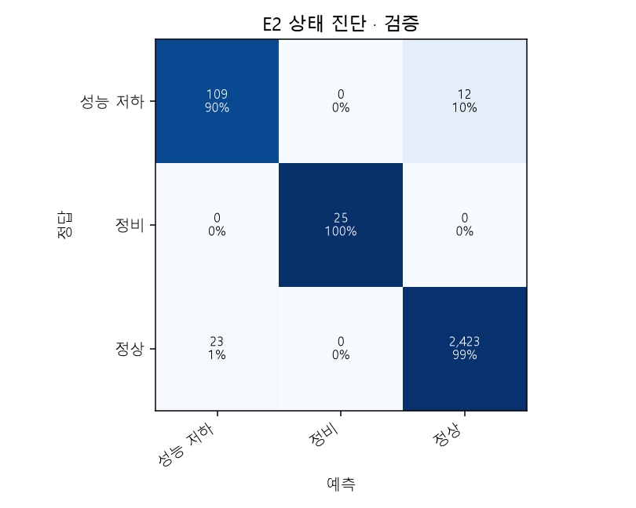

- state 평가 클래스: degraded: 121행, maintenance: 25행, normal: 2,446행.

- state에서 섞었을 때 F1이 가장 감소한 관측: VIB-FNDE_RMS (+0.048), VIB-FDE_RMS (+0.020), RPM (+0.008).

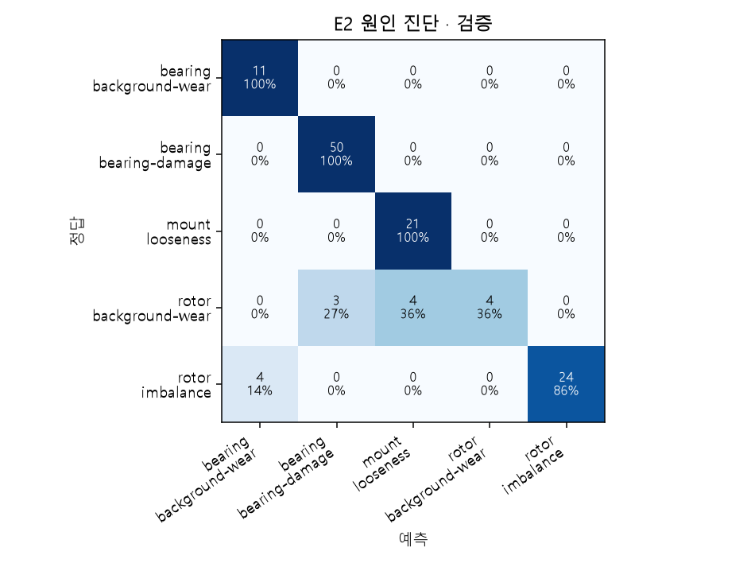

- cause 평가 클래스: bearing::background-wear: 11행, bearing::bearing-damage: 50행, mount::looseness: 21행, rotor::background-wear: 11행, rotor::imbalance: 28행.

- cause에서 섞었을 때 F1이 가장 감소한 관측: VIB-MDE_CRF (+0.483), VIB-FNDE_RMS (+0.072), VIB-MDE_KUR (+0.015).

- 원인 상위 2개 후보 포함률: 100.0%. 부품 정확도: 90.9%.

- 상태 모델까지 포함한 이상 감지율: 90.1%. 실제 이상 시점에서 상태 감지와 원인 1위가 함께 맞은 비율: 81.8%.

| 종류 | 목표 | 상황·시각 | 정답 | 예측 / 2위 후보 | 점수 | 관측 설명 |
|---|---|---|---|---|---:|---|
| confident_error | state | S0245 2027-09-04 12:00:00.500000+00:00 | degraded | normal / degraded | 0.86 | VIB-MDE_KUR: 1.823799967765808 (정상 참조 -1.47, 점수 차이 +0.246) / VIB-MDE_CRF: 3.337100028991699 (정상 참조 1.61, 점수 차이 +0.126) / VIB-MDE_STD: 0.5852000117301941 (정상 참조 0.409, 점수 차이 +0.050) |
| confident_error | state | S0238 2027-08-09 12:00:00.500000+00:00 | degraded | normal / degraded | 0.75 | LOAD: 0.7962999939918518 (정상 참조 0.78, 점수 차이 +0.033) / RPM: 1138.8846435546875 (정상 참조 1.13e+03, 점수 차이 +0.020) / VIB-MNDE_RMS: 0.5041000247001648 (정상 참조 0.406, 점수 차이 +0.020) |
| confident_error | state | S0262 2027-11-12 04:00:00.500000+00:00 | normal | degraded / normal | 0.72 | VIB-MDE_KUR: -0.8014000058174133 (정상 참조 -1.47, 점수 차이 +0.502) / VIB-MDE_CRF: 1.9032000303268433 (정상 참조 1.61, 점수 차이 +0.322) / VIB-MNDE_RMS: 0.5001000165939331 (정상 참조 0.406, 점수 차이 +0.198) |
| uncertain | state | S0262 2027-11-11 14:00:00.500000+00:00 | normal | degraded / normal | 0.50 | VIB-MDE_KUR: -0.7677000164985657 (정상 참조 -1.47, 점수 차이 +0.330) / VIB-MDE_CRF: 1.8811999559402466 (정상 참조 1.61, 점수 차이 +0.147) / VIB-FNDE_RMS: 0.4925000071525574 (정상 참조 0.378, 점수 차이 +0.082) |
| uncertain | state | S0224 2027-06-14 20:00:00.500000+00:00 | normal | normal / degraded | 0.50 | VIB-MDE_CRF: 1.5434999465942383 (정상 참조 1.61, 점수 차이 +0.059) / RPM: 1177.517578125 (정상 참조 1.13e+03, 점수 차이 -0.009) / VIB-MDE_KUR: -1.4878000020980835 (정상 참조 -1.47, 점수 차이 -0.010) |
| uncertain | state | S0264 2027-11-20 22:00:00.500000+00:00 | normal | normal / degraded | 0.50 | VIB-MDE_KUR: -1.4825999736785889 (정상 참조 -1.47, 점수 차이 +0.023) / LOAD: 0.9036999940872192 (정상 참조 0.78, 점수 차이 +0.013) / VIB-MDE_CRF: 1.5628999471664429 (정상 참조 1.61, 점수 차이 +0.010) |
| correct_abnormal | state | S0238 2027-08-08 08:00:00.500000+00:00 | degraded | degraded / maintenance | 1.00 | VIB-FNDE_RMS: 0.7325000166893005 (정상 참조 0.378, 점수 차이 +0.513) / VIB-FDE_RMS: 0.7542999982833862 (정상 참조 0.394, 점수 차이 +0.241) / VIB-MNDE_RMS: 0.7670000195503235 (정상 참조 0.406, 점수 차이 +0.150) |
| correct_abnormal | state | S0240 2027-08-16 14:00:00.500000+00:00 | degraded | degraded / maintenance | 1.00 | VIB-FDE_RMS: 1.4349000453948975 (정상 참조 0.394, 점수 차이 +0.369) / VIB-FNDE_RMS: 1.1832000017166138 (정상 참조 0.378, 점수 차이 +0.338) / VIB-MDE_STD: 1.6862000226974487 (정상 참조 0.409, 점수 차이 +0.234) |
| correct_abnormal | state | S0288 2028-02-25 02:00:00.500000+00:00 | degraded | degraded / maintenance | 1.00 | VIB-FNDE_RMS: 1.325700044631958 (정상 참조 0.378, 점수 차이 +0.443) / VIB-FDE_RMS: 1.3494999408721924 (정상 참조 0.394, 점수 차이 +0.368) / VIB-MNDE_RMS: 1.3691999912261963 (정상 참조 0.406, 점수 차이 +0.236) |
| confident_error | cause | S0288 2028-02-25 20:00:00.500000+00:00 | rotor::background-wear | bearing::bearing-damage / rotor::background-wear | 1.00 | VIB-MDE_CRF: 3.2548999786376953 (정상 참조 1.61, 점수 차이 +0.976) / VIB-MDE_KUR: 1.6114000082015991 (정상 참조 -1.47, 점수 차이 +0.016) / VIB-FNDE_RMS: 0.6309999823570251 (정상 참조 0.378, 점수 차이 +0.000) |
| confident_error | cause | S0238 2027-08-09 16:00:00.500000+00:00 | rotor::background-wear | mount::looseness / rotor::background-wear | 0.97 | VIB-MDE_CRF: 1.9127999544143677 (정상 참조 1.61, 점수 차이 +0.735) / VIB-MDE_KUR: -0.7319999933242798 (정상 참조 -1.47, 점수 차이 +0.131) / VIB-MDE_STD: 0.5275999903678894 (정상 참조 0.409, 점수 차이 +0.018) |
| confident_error | cause | S0264 2027-11-19 16:00:00.500000+00:00 | rotor::imbalance | bearing::background-wear / rotor::imbalance | 0.83 | VIB-MDE_CRF: 1.5641000270843506 (정상 참조 1.61, 점수 차이 +0.055) / VIB-MDE_RMS: 0.9939000010490417 (정상 참조 0.409, 점수 차이 +0.019) / VIB-MDE_KUR: -1.472000002861023 (정상 참조 -1.47, 점수 차이 +0.000) |
| uncertain | cause | S0264 2027-11-21 02:00:00.500000+00:00 | rotor::imbalance | bearing::background-wear / rotor::imbalance | 0.55 | VIB-MDE_CRF: 1.568600058555603 (정상 참조 1.61, 점수 차이 +0.063) / RPM: 1110.3011474609375 (정상 참조 1.13e+03, 점수 차이 -0.000) / VIB-MDE_KUR: -1.4807000160217285 (정상 참조 -1.47, 점수 차이 -0.000) |
| uncertain | cause | S0240 2027-08-16 00:00:00.500000+00:00 | rotor::imbalance | rotor::imbalance / bearing::background-wear | 0.98 | VIB-FNDE_RMS: 0.45579999685287476 (정상 참조 0.378, 점수 차이 +0.948) / VIB-FDE_RMS: 0.6675999760627747 (정상 참조 0.394, 점수 차이 +0.046) / VIB-MNDE_RMS: 0.8090000152587891 (정상 참조 0.406, 점수 차이 +0.026) |
| uncertain | cause | S0288 2028-02-23 18:00:00.500000+00:00 | bearing::bearing-damage | bearing::bearing-damage / rotor::background-wear | 1.00 | VIB-MDE_CRF: 3.419300079345703 (정상 참조 1.61, 점수 차이 +0.929) / VIB-MDE_KUR: 2.301800012588501 (정상 참조 -1.47, 점수 차이 +0.007) / VIB-FDE_RMS: 0.6829000115394592 (정상 참조 0.394, 점수 차이 +0.000) |
| correct_abnormal | cause | S0240 2027-08-16 12:00:00.500000+00:00 | rotor::imbalance | rotor::imbalance / bearing::background-wear | 1.00 | VIB-FNDE_RMS: 1.0592000484466553 (정상 참조 0.378, 점수 차이 +0.053) / VIB-MDE_RMS: 1.5843000411987305 (정상 참조 0.409, 점수 차이 +0.000) / VIB-MDE_STD: 1.5809999704360962 (정상 참조 0.409, 점수 차이 +0.000) |
| correct_abnormal | cause | S0288 2028-02-24 16:00:00.500000+00:00 | bearing::bearing-damage | bearing::bearing-damage / bearing::background-wear | 1.00 | VIB-MDE_CRF: 3.425100088119507 (정상 참조 1.61, 점수 차이 +0.966) / VIB-MDE_KUR: 2.680500030517578 (정상 참조 -1.47, 점수 차이 +0.011) / VIB-FDE_RMS: 1.1887999773025513 (정상 참조 0.394, 점수 차이 +0.000) |
| correct_abnormal | cause | S0245 2027-09-06 04:00:00.500000+00:00 | bearing::bearing-damage | bearing::bearing-damage / bearing::background-wear | 1.00 | VIB-MDE_CRF: 3.4547998905181885 (정상 참조 1.61, 점수 차이 +0.944) / VIB-MDE_KUR: 2.808199882507324 (정상 참조 -1.47, 점수 차이 +0.016) / VIB-FDE_RMS: 0.9890999794006348 (정상 참조 0.394, 점수 차이 +0.000) |

### 설비 F

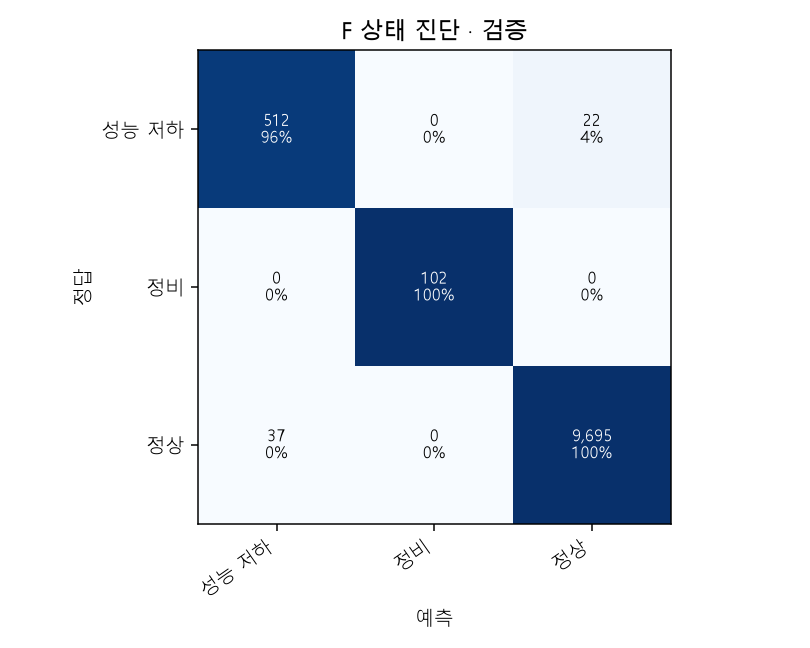

- state 평가 클래스: degraded: 534행, maintenance: 102행, normal: 9,732행.

- state에서 섞었을 때 F1이 가장 감소한 관측: VIB-AGT_KUR (+0.163), VIB-AGT_CRF (+0.122), LOAD (+0.002).

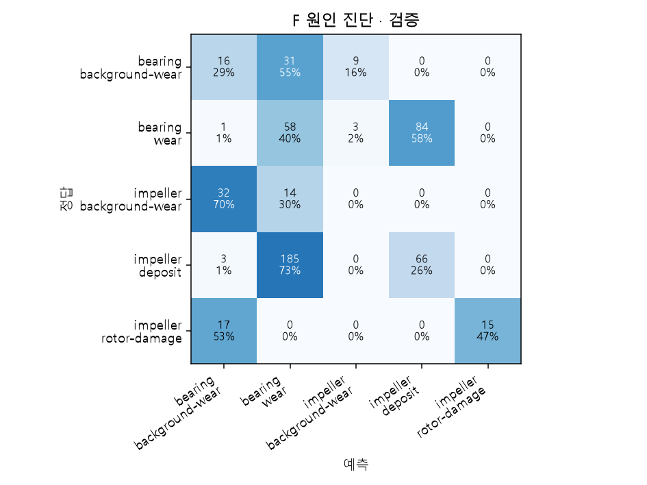

- cause 평가 클래스: bearing::background-wear: 56행, bearing::wear: 146행, impeller::background-wear: 46행, impeller::deposit: 254행, impeller::rotor-damage: 32행.

- cause에서 섞었을 때 F1이 가장 감소한 관측: VIB-AGT_KUR (+0.074), VIB-AGT_CRF (+0.049), MISSING_RATE (+0.000).

- 원인 상위 2개 후보 포함률: 87.1%. 부품 정확도: 35.0%.

- 상태 모델까지 포함한 이상 감지율: 95.9%. 실제 이상 시점에서 상태 감지와 원인 1위가 함께 맞은 비율: 26.0%.

| 종류 | 목표 | 상황·시각 | 정답 | 예측 / 2위 후보 | 점수 | 관측 설명 |
|---|---|---|---|---|---:|---|
| confident_error | state | S0266 2027-11-28 17:00:00.500000+00:00 | degraded | normal / degraded | 1.00 | VISCOSITY: 1.1841000318527222 (정상 참조 1, 점수 차이 +0.000) / VIB-AGT_RMS: 0.42149999737739563 (정상 참조 0.401, 점수 차이 +0.000) / VIB-AGT_STD: 0.42100000381469727 (정상 참조 0.4, 점수 차이 +0.000) |
| confident_error | state | S0250 2027-09-24 09:30:00.500000+00:00 | normal | degraded / normal | 0.99 | VIB-AGT_KUR: -1.4085999727249146 (정상 참조 -1.46, 점수 차이 +0.973) / VIB-AGT_CRF: 1.73580002784729 (정상 참조 1.58, 점수 차이 +0.779) / VISCOSITY: 0.9265000224113464 (정상 참조 1, 점수 차이 +0.002) |
| confident_error | state | S0256 2027-10-19 21:00:00.500000+00:00 | normal | degraded / normal | 0.99 | VIB-AGT_KUR: 1.6610000133514404 (정상 참조 -1.46, 점수 차이 +0.591) / VIB-AGT_STD: 0.5975000262260437 (정상 참조 0.4, 점수 차이 +0.181) / VIB-AGT_CRF: 3.222100019454956 (정상 참조 1.58, 점수 차이 +0.169) |
| uncertain | state | S0256 2027-10-20 02:30:00.500000+00:00 | degraded | degraded / normal | 0.50 | VIB-AGT_RMS: 0.649399995803833 (정상 참조 0.401, 점수 차이 +0.436) / VIB-AGT_STD: 0.6485999822616577 (정상 참조 0.4, 점수 차이 +0.317) / VIB-AGT_KUR: 1.2233999967575073 (정상 참조 -1.46, 점수 차이 +0.291) |
| uncertain | state | S0250 2027-09-26 20:00:00.500000+00:00 | degraded | normal / degraded | 0.51 | VISCOSITY: 1.1992000341415405 (정상 참조 1, 점수 차이 +0.079) / VIB-AGT_RMS: 0.39239999651908875 (정상 참조 0.401, 점수 차이 +0.054) / LOAD: 0.8532000184059143 (정상 참조 0.78, 점수 차이 +0.023) |
| uncertain | state | S0259 2027-10-31 01:00:00.500000+00:00 | degraded | degraded / normal | 0.52 | VIB-AGT_KUR: -1.4119000434875488 (정상 참조 -1.46, 점수 차이 +0.488) / VIB-AGT_CRF: 1.7493000030517578 (정상 참조 1.58, 점수 차이 +0.347) / LOAD: 0.6901000142097473 (정상 참조 0.78, 점수 차이 -0.116) |
| correct_abnormal | state | S0272 2027-12-23 02:30:00.500000+00:00 | degraded | degraded / maintenance | 1.00 | VIB-AGT_CRF: 2.0144999027252197 (정상 참조 1.58, 점수 차이 +0.267) / VIB-AGT_KUR: -1.2062000036239624 (정상 참조 -1.46, 점수 차이 +0.122) / VIB-AGT_RMS: 0.4918999969959259 (정상 참조 0.401, 점수 차이 +0.000) |
| correct_abnormal | state | S0250 2027-09-25 01:30:00.500000+00:00 | degraded | degraded / maintenance | 1.00 | VIB-AGT_CRF: 1.9026000499725342 (정상 참조 1.58, 점수 차이 +0.383) / VIB-AGT_KUR: -1.3114999532699585 (정상 참조 -1.46, 점수 차이 +0.276) / LOAD: 0.6255000233650208 (정상 참조 0.78, 점수 차이 +0.000) |
| correct_abnormal | state | S0266 2027-11-29 12:30:00.500000+00:00 | degraded | degraded / maintenance | 1.00 | VIB-AGT_CRF: 1.9744999408721924 (정상 참조 1.58, 점수 차이 +0.283) / VIB-AGT_KUR: -1.2694000005722046 (정상 참조 -1.46, 점수 차이 +0.177) / LOAD: 0.8883000016212463 (정상 참조 0.78, 점수 차이 +0.000) |
| confident_error | cause | S0251 2027-09-29 08:00:00.500000+00:00 | bearing::wear | impeller::deposit / bearing::wear | 0.74 | VIB-AGT_KUR: -1.1647000312805176 (정상 참조 -1.46, 점수 차이 +0.411) / VIB-AGT_CRF: 2.0488998889923096 (정상 참조 1.58, 점수 차이 +0.408) / VISCOSITY: 0.8392999768257141 (정상 참조 1, 점수 차이 +0.298) |
| confident_error | cause | S0272 2027-12-23 10:30:00.500000+00:00 | impeller::deposit | bearing::wear / impeller::deposit | 0.65 | VIB-AGT_KUR: -1.1621999740600586 (정상 참조 -1.46, 점수 차이 +0.313) / VIB-AGT_CRF: 2.021699905395508 (정상 참조 1.58, 점수 차이 +0.270) / VISCOSITY: 1.1639000177383423 (정상 참조 1, 점수 차이 +0.164) |
| confident_error | cause | S0259 2027-10-31 16:00:00.500000+00:00 | impeller::deposit | bearing::wear / impeller::deposit | 0.64 | VIB-AGT_KUR: -1.2200000286102295 (정상 참조 -1.46, 점수 차이 +0.299) / VIB-AGT_CRF: 1.8885999917984009 (정상 참조 1.58, 점수 차이 +0.269) / VIB-AGT_RMS: 0.5163999795913696 (정상 참조 0.401, 점수 차이 +0.175) |
| uncertain | cause | S0250 2027-09-25 05:00:00.500000+00:00 | impeller::deposit | impeller::deposit / bearing::wear | 0.42 | VIB-AGT_KUR: -1.3021999597549438 (정상 참조 -1.46, 점수 차이 +0.151) / VIB-AGT_CRF: 1.9270000457763672 (정상 참조 1.58, 점수 차이 +0.077) / VIB-AGT_RMS: 0.39559999108314514 (정상 참조 0.401, 점수 차이 +0.020) |
| uncertain | cause | S0251 2027-09-28 10:30:00.500000+00:00 | bearing::wear | impeller::deposit / bearing::wear | 0.32 | VISCOSITY: 1.1992000341415405 (정상 참조 1, 점수 차이 +0.074) / VIB-AGT_KUR: -1.4069000482559204 (정상 참조 -1.46, 점수 차이 +0.021) / VIB-AGT_RMS: 0.4823000133037567 (정상 참조 0.401, 점수 차이 +0.009) |
| uncertain | cause | S0266 2027-11-27 13:00:00.500000+00:00 | bearing::wear | bearing::wear / impeller::deposit | 0.45 | VISCOSITY: 1.1332000494003296 (정상 참조 1, 점수 차이 +0.146) / VIB-AGT_KUR: -1.395300030708313 (정상 참조 -1.46, 점수 차이 +0.127) / VIB-AGT_CRF: 1.7620999813079834 (정상 참조 1.58, 점수 차이 +0.076) |
| correct_abnormal | cause | S0256 2027-10-20 06:00:00.500000+00:00 | impeller::rotor-damage | impeller::rotor-damage / bearing::background-wear | 0.57 | VIB-AGT_CRF: 3.093400001525879 (정상 참조 1.58, 점수 차이 +0.310) / VIB-AGT_KUR: 1.3609999418258667 (정상 참조 -1.46, 점수 차이 +0.309) / VIB-AGT_RMS: 0.6291000247001648 (정상 참조 0.401, 점수 차이 +0.202) |
| correct_abnormal | cause | S0266 2027-11-29 17:30:00.500000+00:00 | bearing::wear | bearing::wear / impeller::deposit | 0.50 | VIB-AGT_KUR: -1.176300048828125 (정상 참조 -1.46, 점수 차이 +0.209) / VIB-AGT_CRF: 2.0009000301361084 (정상 참조 1.58, 점수 차이 +0.146) / VIB-AGT_RMS: 0.4325000047683716 (정상 참조 0.401, 점수 차이 +0.109) |
| correct_abnormal | cause | S0250 2027-09-25 14:30:00.500000+00:00 | impeller::deposit | impeller::deposit / bearing::wear | 0.50 | VIB-AGT_KUR: -1.2482000589370728 (정상 참조 -1.46, 점수 차이 +0.239) / VIB-AGT_CRF: 1.854699969291687 (정상 참조 1.58, 점수 차이 +0.161) / VIB-AGT_RMS: 0.4390000104904175 (정상 참조 0.401, 점수 차이 +0.098) |

## 관측 설명의 의미와 한계

관측 중요도는 검증 표본 최대 1,500행에서 센서별 특징 묶음을 두 번 섞어 Macro-F1이 얼마나 감소하는지 확인한 값입니다. 상관된 센서끼리는 중요도가 나뉠 수 있습니다. 검증 중요도는 사후 설명용이며 이번 모델의 특징 선택에 사용하지 않았습니다.
사례 설명은 한 센서의 특징 묶음을 학습 정상 시점의 중앙값으로 바꿨을 때 예측 점수가 얼마나 감소하는지 보여줍니다. 정상 참조는 부하를 정확히 일치시킨 비교가 아니며, 그 값을 실제로 바꾸면 고장이 해결된다는 인과 설명이 아닙니다. 음수면 그 관측이 해당 판단을 지지하지 않는 방향입니다.
A/C의 __now는 마지막 5분 구간의 평균입니다. B의 __now는 같은 시각의 위치별 평균입니다. 표준편차·오차 특징의 단위는 원 관측 또는 해당 파생량의 단위입니다.
공개된 diagnostics는 합성 엔진의 상태·원인 정답입니다. 실제 설비와 고장 원인을 확정하는 성능으로 일반화할 수 없습니다. 특히 failed가 없거나 적은 설비의 고장 진단은 별도 검증이 필요합니다.
D/E/F는 관측 간격이 각각 약 5분/2시간/30분입니다. 출력이 없는 시각을 새 측정으로 간주하지 말고 마지막 관측 시각과 경과 시간을 화면에 표시해야 합니다.
## 저장된 결과

- metrics_summary.csv: 설비·목표별 핵심 성능.
- tables/*_metrics.json: 클래스별 성능, 확률 보정 결과, 전체 혼동행렬.
- tables/*_cases.json: 대표 혼동·불확실·정답 사례와 관측 설명.
- predictions/*_validation.csv.gz: 검증 정답과 예측 비교. gzip CSV이므로 pandas.read_csv로 바로 읽을 수 있습니다.
- predictions/*_dashboard_test.csv.gz: 정답 없는 시험 자료의 화면 연동용 출력.
- tables/*_latest_test.csv: 시험 상황별 마지막 관측의 작은 예측 표.
- models/*_state.joblib, *_cause.joblib: 재사용 가능한 모델과 보정·보류 기준.
- features/*.joblib: 재실행 속도를 위한 특징 캐시. 센서 입력과 정답 칼럼은 분리됩니다.
- run_manifest.json: 실행 환경, 분할, 입력 서명, 명시적 특징 목록.

## 다시 실행

CH.4 폴더에서 `python Diagnosis.py`를 실행하면 전체를 생성합니다. 입력이 바뀌지 않았다면 `python Diagnosis.py --reuse-features`로 특징 생성 시간을 줄일 수 있습니다.
`python Diagnosis.py --equipment C --output Results/Diagnosis_C`로 설비 하나만 별도 실행할 수 있습니다. 기존 Main.py는 전처리용이므로 학습을 위해 실행할 필요가 없습니다.
기존 모델로 새 시나리오를 진단하려면 `python Diagnosis.py --predict-scenario S0289 --equipment C`를 실행합니다. 원인 후보는 상태 결과로 게이트되며 정답 칼럼을 읽지 않습니다.
